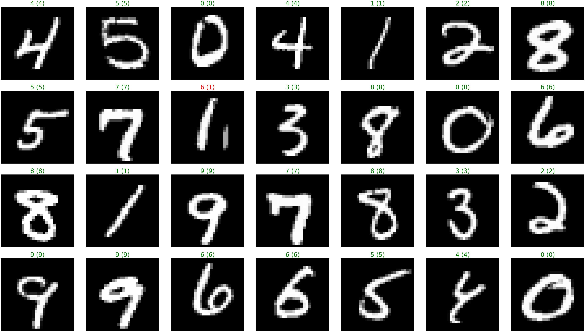
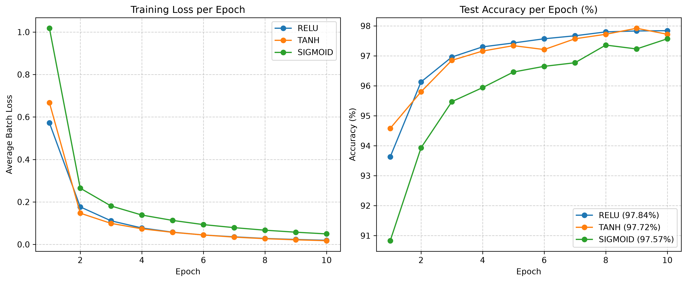
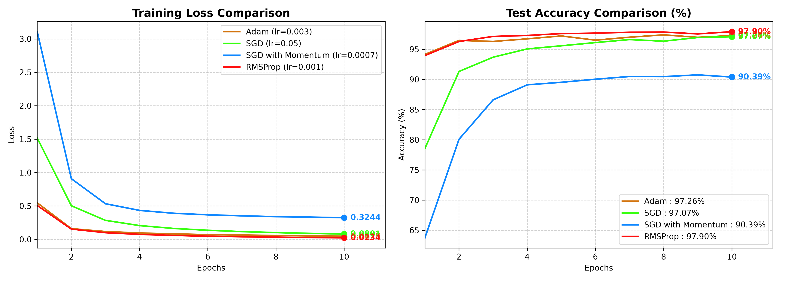
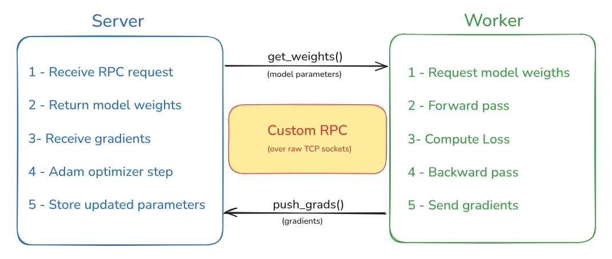
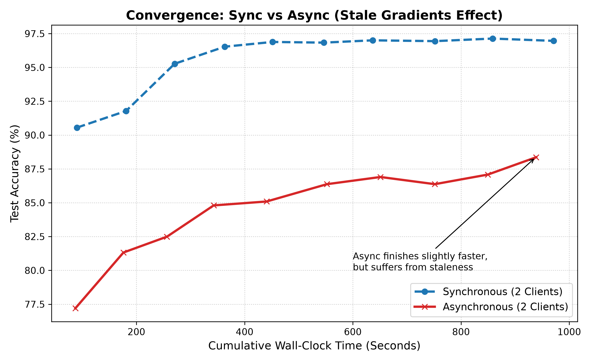

# dist-ml-framework

📄 **[Read the 5-Page IEEE Technical Report here](paper/Makdad_DeepLearning_DistributedRPC.pdf)**

## Part 1: The Autograd Engine

A lightweight, $N$-dimensional tensor library and automatic differentiation engine built from scratch in Python and NumPy.

Inspired by [micrograd](https://github.com/karpathy/micrograd), but scaled up from scalar values to vectorized tensor operations.

## Dependencies

* Python 3.8+
* NumPy
* Matplotlib (for running benchmarks)
* Torchvision (for downloading the MNIST dataset)

```bash
pip install numpy matplotlib torchvision

```

## Quick Example

```python
import numpy as np
from micrograd.multi_dim_engine import Tensor

# Define tensors with gradient tracking
a = Tensor(np.array([[1.0, 2.0], [3.0, 4.0]]))
b = Tensor(np.array([[2.0, 0.0], [1.0, 3.0]]))

# Forward pass
c = a @ b
d = c.relu()
loss = d.sum()

# Backward pass
loss.backward()

print("a grad:\n", a.grad) #prints a grad: [[2. 4.],[2. 4.]]
 
print("b grad:\n", b.grad) #prints b grad: [[4. 4.],[6. 6.]]
 
```

## Running MNIST

We evaluated a 3-layer MLP ($784 \to 128 \to 64 \to 10$) trained with custom Adam optimizer and fused Softmax Cross-Entropy loss across 10 epochs. Where we reached a 97.72% accuracy and a 0.0175 final loss.



## Results (PyTorch Comparaison)

To validate correctness, the custom engine was benchmarked directly against PyTorch on MNIST, using identical architecture, hyperparameters, and initial weights (both models seeded identically to eliminate initialization as a confounding variable, in other words, to eliminate the luck factor for both models)

### Training Curves :

Loss trajectory and test accuracy over 10 epochs, custom engine vs PyTorch :


Across 10 independent seeds, loss trajectories remain nearly indistinguishable throughout training, and final test accuracy is statistically comparable between implementations.

### Statistical Summary (10 Seeds)

| Seed | Custom Final Acc (%) | PyTorch Final Acc (%) | Custom Final Loss | PyTorch Final Loss |
|------|----------------------|-----------------------|-------------------|--------------------|
| 0    | 97.55                | 97.47                 | 0.0272            | 0.0286             |
| 1    | 97.59                | 97.88                 | 0.0264            | 0.0309             |
| 2    | 97.62                | 97.42                 | 0.0301            | 0.0295             |
| 3    | 97.63                | 97.29                 | 0.0275            | 0.0290             |
| 4    | 97.46                | 97.41                 | 0.0283            | 0.0289             |
| 5    | 97.41                | 97.73                 | 0.0261            | 0.0319             |
| 6    | 97.86                | 97.54                 | 0.0287            | 0.0282             |
| 7    | 97.82                | 96.95                 | 0.0260            | 0.0322             |
| 8    | 97.65                | 97.74                 | 0.0292            | 0.0291             |
| 9    | 97.62                | 97.09                 | 0.0285            | 0.0307             |
| **Mean ± Std** | **97.62% ± 0.13%** | **97.45% ± 0.28%** | **0.0278 ± 0.0014** | **0.0299 ± 0.0014** |

Across 10 seeds, the custom engine's mean accuracy is marginally higher than PyTorch's, with overlapping standard deviations — indicating the two implementations are statistically equivalent, not meaningfully different.

### Performance

| | Custom Engine | PyTorch |
|---|---|---|
| Avg. time/epoch | 5.87s | 2.28s |
| Avg. total training time (10 epochs) | 58.7s | 22.8s |

PyTorch is roughly 2.5x faster, due to its optimized C++/CUDA backend; this implementation prioritizes correctness, transparency, and educational clarity (every operation implemented and readable in pure Python/NumPy) over raw performance.

### Reproduce

```bash
python experiments/pytorch_comparaison/pytorch_parity_benchmark.py
```

## Activations Benchmark

After completing the `multi_dim_engine` and training a neural network (`neural_network.py`) using the ReLU activation function—reaching over 97.5% accuracy on MNIST dataset. We wanted to see what kind of differences would appear when using other activation functions like Sigmoid and Tanh. Since these are also among the most famous activation functions, we decided to compare them side-by-side so we could see firsthand why ReLU is so popular and why it remains the default choice in modern neural networks.

The results are illustrated in the graph below : 



| Activation | Test Accuracy | Final Loss |
|---|---|---|
| ReLU | 97.84% | 0.0193 |
| Tanh | 97.72% | 0.0175 |
| Sigmoid | 97.57% | 0.0494 |

### Reproduce

```bash
python experiments/compare_activations.py
```

## Optimizers Benchmark

Following the activation function tests, we compared four main optimizers— SGD, SGD with Momentum (SGDM), RMSProp, and Adam —on the MNIST dataset to see how learning rate adjustments and momentum affect training speed and accuracy.

While **RMSProp** finished with the highest score (97.90%), **Adam** (97.26%) clearly showed why it is the default choice for most neural networks. Adam worked almost perfectly on the very first try using default settings (`lr=0.003`), needing zero time spent on tweaking parameters.

In contrast, the other optimizers required a lot of extra effort:

* **SGD & SGDM:** Finding the right learning rate took hours of frustrating trial-and-error. Small mistakes caused the models to fail completely (getting stuck at 11.35% accuracy) or learn too slowly. Even after a lot of tuning (`lr=0.0007`), SGDM only reached 90.39%, while plain SGD eventually hit 97.07% (`lr=0.05`).

* **RMSProp:** It got the top score (97.90%), but only after adjusting the learning rate down to `0.001` so it wouldn't jump past the best solutions.

This test proves a big practical point: while traditional methods like SGD can get good results if you spend hours tweaking them, Adam saves developers tons of time by giving great performance right away.

The results are illustrated in the graph below:



| Optimizer | Test Accuracy | Final Loss |
|---|---|---|
| Adam | 97.26% | 0.0475 |
| SGD | 97.07% | 0.0801 |
| SGD with momentum | 90.39% | 0.3244 |
| RMSProp | 97.90% | 0.0234 |

### Reproduce

```bash
python experiments/compare_optimizers.py
```

## Under the Hood

* **The Computational Graph:** As you do operations (`+`, `@`, `relu`), we track them in a directed graph. Calling `.backward()` visits nodes in reverse topological order so every tensor gets its gradients in the exact right sequence.
* **Vectorized Autograd:** Instead of tracking scalar floats one-by-one, we track $N$-dimensional arrays. Matrix multiplications use transpose rules, and batch broadcasting automatically sums gradients back down to match the original tensor shape.
* **Fused Loss Trick:** Softmax and Cross-Entropy are merged into a single clean math step ($\frac{\partial L}{\partial z_i} = p_i - y_i$). We subtract the maximum value before exponentiating so numbers don't explode into `inf` or `NaN`.
* **Adam Optimizer:** Maintains two running averages per parameter - a first moment (exponential moving average of the gradient) and a second (exponetial moving average of the squared gradient). Since both start at zero, early estimates are biased towards zero; we apply bias correction to compensate, dividing each moment by a factor that approaches 1 as training progresses. The final parameter update scales the gradient average by the inverse square root of the squared gradient average - this is what makes Adam "adaptive":parameteres with consistently large gradients get smaller effective steps, and vise-versa. 

## Part 2: Distributed Training System

### Architecture

The distributed system follows a parameter server pattern:
- **Server**: holds the master copy of model weights and the Adam optimizer
- **Workers**: connect once, then repeatedly pull weights, train locally on a batch, and push gradients back

All communication goes through a custom RPC layer built directly on raw TCP sockets — no gRPC, no pickle (pickle can execute arbitrary code on deserialization, a real security risk over a network). Tensors are serialized with their own lightweight protocol: a JSON header (dtype, shape, length) followed by raw bytes, with multiple tensors batched into a single transmission.



### The Network Bottleneck

The first working version synchronized on every batch and was correct, but slow: ~6 minutes per epoch, against 5.87s for local single-machine training. Three optimizations were applied in sequence:

| Stage | Epoch Time |
|---|---|
| Per-batch sync (baseline) | ~6 min |
| Batched tensor transmission | 90 s |
| Float16 compression | 85 s |
| TCP_NODELAY enabled | 8.14 s |

**Batching** removed the overhead of a separate network round-trip per tensor. **Float16 compression** halved the data volume, a smaller gain since most overhead was already gone. **TCP_NODELAY** was the biggest fix: by default, TCP's Nagle's algorithm delays small packets to batch them for network efficiency — great for bulk transfer, bad for frequent small request/response cycles like ours. Disabling it removed that artificial delay.

### Synchronous vs. Asynchronous Training

With two workers, two coordination strategies were compared:
- **Asynchronous**: each worker independently pulls weights, trains, and pushes gradients, with no coordination — whichever gradient arrives first gets applied first
- **Synchronous**: the server waits for both workers' gradients each round, averages them, and applies one update, using `threading.Condition` to coordinate



| Mode | Total Training Time (10 epochs) | Final Accuracy |
|---|---|---|
| Asynchronous | 946.33 s | 87.67% (avg of both workers) |
| Synchronous | 980.49 s | 96.96% (avg of both workers) |

The result is not what naive intuition predicts. Asynchronous training is not meaningfully faster in wall-clock time here, and converges to noticeably lower accuracy. Likely causes:
- **Gradient staleness**: with two workers continuously pushing without coordination, gradients are frequently applied against weights that have already moved
- **Contention without true parallelism**: Python's GIL means two threads competing for the same server resources don't run truly concurrently, eroding async's theoretical speed advantage
- **Synchronous averaging acts like a larger effective batch**, which is more stable despite the wait

This matches a real, known tradeoff in distributed training research, not a bug in the implementation — it confirms that synchronization frequency and staleness meaningfully affect convergence, exactly the kind of result this experiment was designed to surface.

### Known Bugs Encountered

- **Serialization crash on tensor-containing responses**: `dispatch`'s response could itself contain a Tensor (e.g., `get_weights`), which isn't JSON-serializable — fixed by applying the same placeholder-and-separate-transmission pattern used for requests, symmetrically, to responses.
- **Race condition in synchronous mode**: using `.append()` to collect two workers' gradients allowed a fast worker to "lap" a slow one still waiting to be rescheduled, corrupting the shared list's expected length. Fixed by switching to direct assignment per round instead of accumulating, so each round's data is always complete and unambiguous regardless of thread scheduling timing.

---

## ⚖️ License

This project is licensed under the MIT License - see the [LICENSE](LICENSE) file for details.